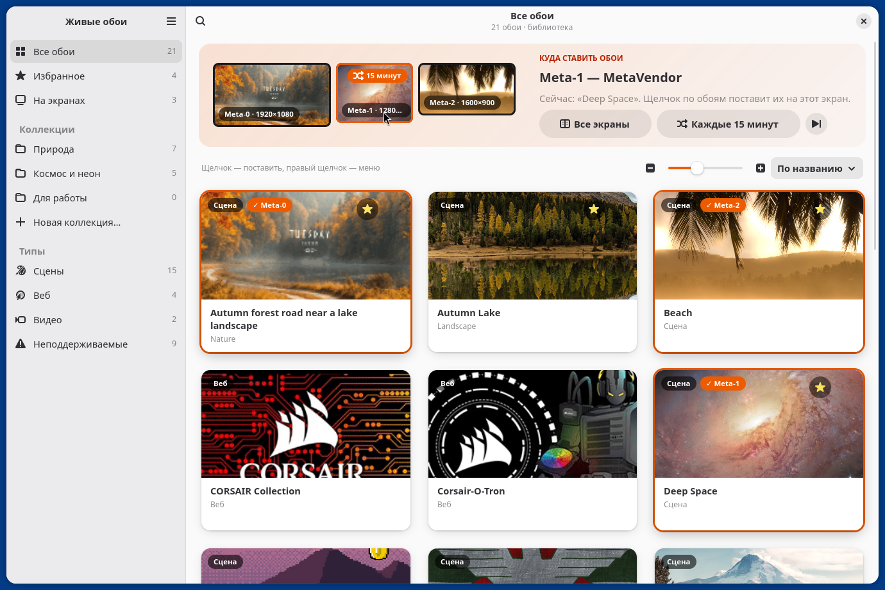
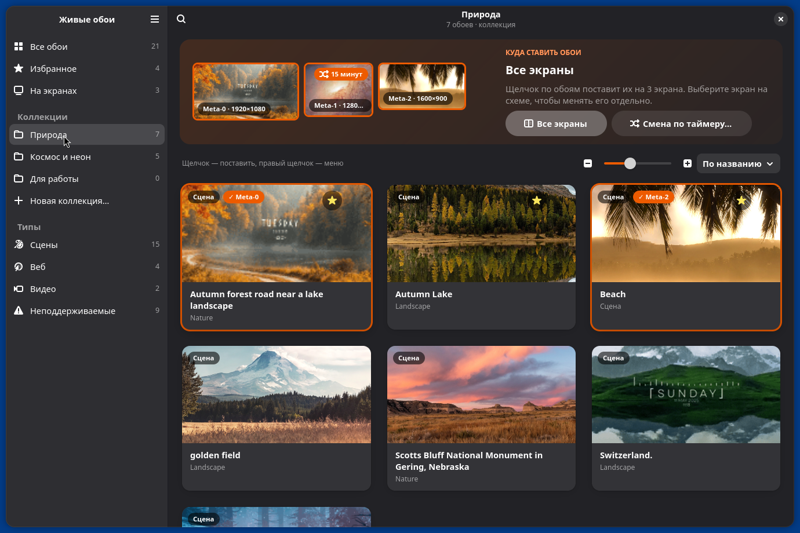
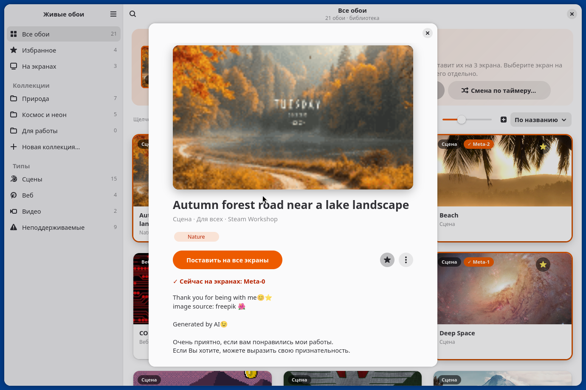
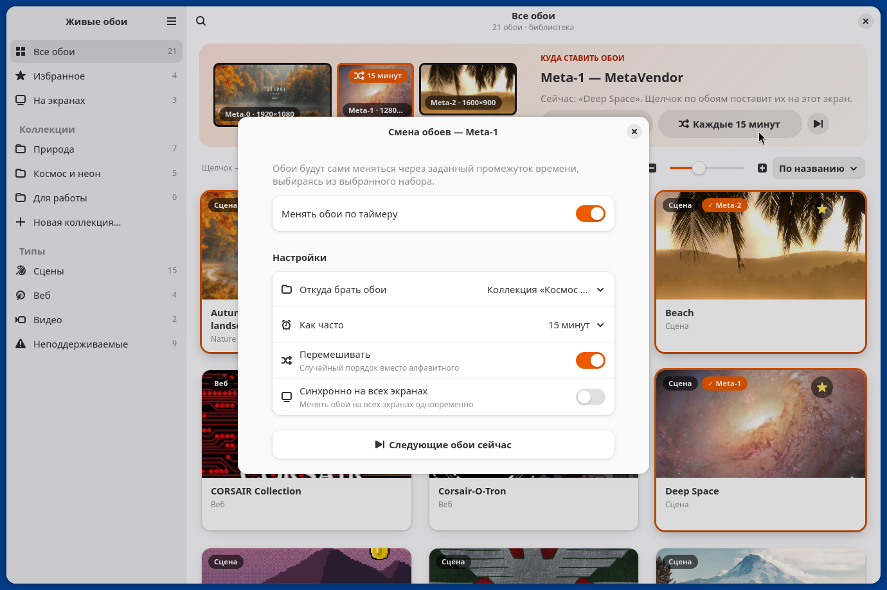
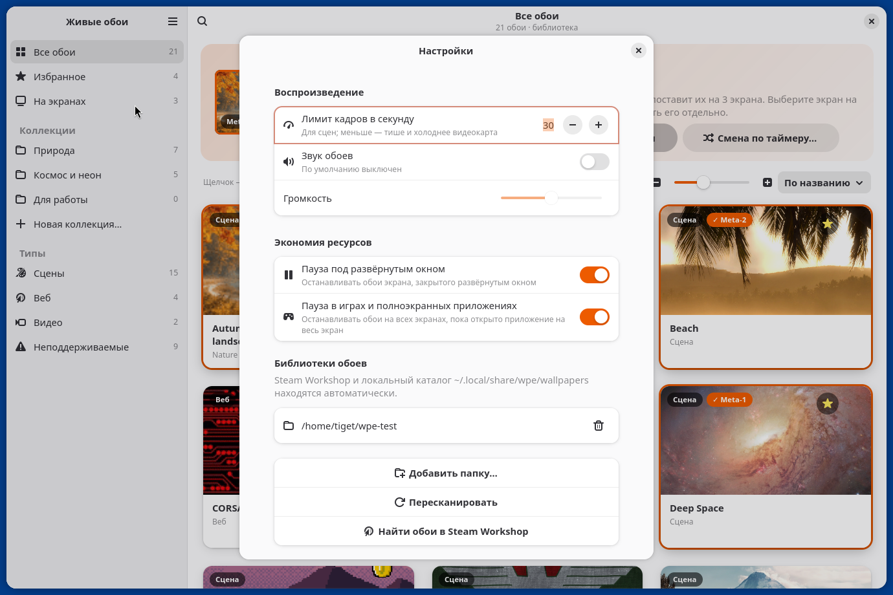

# Живые обои для GNOME (WPE)

**English:** WPE is a live-wallpaper engine for GNOME Shell 50 on Wayland (tested on Ubuntu 26.04 with NVIDIA).
It plays video, interactive web and Wallpaper Engine *scene* wallpapers (Steam Workshop, appid 431960) as the
desktop background, forwards pointer input to them, feeds web wallpapers with an audio spectrum, pauses when a
window covers the monitor, supports several monitors and ships a libadwaita gallery (GUI) and a CLI.
Scenes are rendered by a patched [linux-wallpaperengine](https://github.com/Almamu/linux-wallpaperengine).
Docs are in Russian; code and comments are in English. License: GPL-3.0-or-later.

---

Аналог Wallpaper Engine для **Ubuntu 26.04 / GNOME Shell 50 (Wayland)**: видео, web-обои с интерактивом и
сцены Wallpaper Engine из Steam Workshop прямо на рабочем столе, под всеми окнами.



## Возможности

- **Video** — зацикленное видео, масштаб «cover», аппаратное декодирование (NVIDIA `nvcodec`), звук выключен по умолчанию.
- **Web** — HTML-обои в WebKitGTK 6 с шимом API Wallpaper Engine: свойства (`applyUserProperties`), курсор и клики,
  пауза, лимит FPS.
- **Scene** — сцены WE через подпроцесс [linux-wallpaperengine](https://github.com/Almamu/linux-wallpaperengine)
  (с нашими патчами): курсор/параллакс, свойства, FPS, звук.
- **Интерактив** — курсор и клики с пустого рабочего стола (в том числе поверх Desktop Icons NG) доходят до обоев.
- **Аудиоспектр** — захват монитора выхода по умолчанию через PipeWire, 64+64 полосы, 30 Гц для web-обоев
  (`wallpaperRegisterAudioListener`) и сцен.
- **Пауза** — при развёрнутом/полноэкранном окне, закрывающем монитор, при блокировке экрана; отдельно — при
  полноэкранном приложении на любом мониторе (игры). Настраивается.
- **Несколько мониторов** — свои обои на каждый монитор или одни на все, горячее подключение.
- **Галерея** — GTK4/libadwaita: схема мониторов в реальных пропорциях (щелчок по экрану, затем по обоям — и они
  на нём), крупные карточки с анимированным превью при наведении, избранное и коллекции, смена обоев по таймеру
  на каждый экран, окно обоев с описанием, тегами и редактором свойств (slider, bool, combo, color, textinput),
  поиск, сортировка, светлая и тёмная тема.
- **CLI** — `wpe-gallery` с аргументами; D-Bus API для своих интеграций.

| | |
|---|---|
|  |  |
|  |  |

## Требования

- Ubuntu 26.04 (или другой дистрибутив с **GNOME Shell 50**), сеанс **Wayland**.
- Проверено на NVIDIA (проприетарный драйвер 580, GTX 1660 SUPER). На других GPU не проверялось.
- Rust (через rustup), `sudo` нужен только для `apt`; установка WPE идёт в `$HOME`.
- Для сцен и встроенных обоев — купленный Wallpaper Engine в Steam.

## Установка

```sh
sudo apt install build-essential pkg-config git curl \
  libgtk-4-dev libadwaita-1-dev libwebkitgtk-6.0-dev \
  libgstreamer1.0-dev libgstreamer-plugins-base1.0-dev libgstreamer-plugins-bad1.0-dev \
  gstreamer1.0-plugins-good gstreamer1.0-plugins-bad gstreamer1.0-libav gstreamer1.0-gl gstreamer1.0-gtk4 \
  libpipewire-0.3-dev libspa-0.2-dev clang libclang-dev
curl https://sh.rustup.rs -sSf | sh            # Rust без sudo

git clone https://github.com/DrTiget/gnome-live-wallpapers.git
cd gnome-live-wallpapers
scripts/install.sh      # сборка и установка в ~/.local: wpe-daemon, wpe-gallery, systemd --user unit,
                        # расширение GNOME Shell, .desktop и иконка
```

**Сцены** (по желанию, ~15 минут, ~1,5 ГБ вместе с CEF):

```sh
sudo apt install cmake libglfw3-dev libglew-dev libglm-dev libsdl2-dev liblz4-dev \
  libavcodec-dev libavformat-dev libavutil-dev libswscale-dev libswresample-dev libmpv-dev libpulse-dev \
  libfftw3-dev libxrandr-dev libxinerama-dev libxcursor-dev libxi-dev libxxf86vm-dev \
  libwayland-dev wayland-protocols libxkbcommon-dev libegl-dev libgl-dev libfreetype-dev libfontconfig-dev \
  libpng-dev libgmp-dev libffi-dev libdbus-1-dev libzstd-dev
scripts/build-scene-renderer.sh   # → ~/.local/lib/linux-wallpaperengine + симлинк в ~/.local/bin
```

### Первый запуск

1. **Выйдите из сеанса и войдите снова.** Wayland подхватывает новые расширения GNOME Shell только при входе.
   `install.sh` уже включил расширение, демон стартует вместе с сеансом.
2. Проверьте: `gnome-extensions info wpe@wpe.github.io` (должно быть `State: ACTIVE`).
3. Откройте **«Живые обои»** в меню приложений (или `wpe-gallery`), выберите обои, нажмите «Применить».

Если демон не запущен, галерея предложит его запустить (`systemctl --user start wpe-daemon`).

## Использование

### GUI

Клик по карточке — панель свойств справа; двойной клик или «Применить» — поставить обои на выбранный монитор
(«Все мониторы» или конкретный). Текущие обои помечены. Свойства применяются сразу. Меню → «Настройки»:
лимит FPS, звук и громкость, пауза, каталоги библиотек, пересканирование. Переключатель
«Показать неподдерживаемые» показывает серым обои, которые демон не умеет рисовать (с причиной).

### CLI

Без аргументов `wpe-gallery` открывает GUI; с аргументами — CLI поверх D-Bus (демон должен работать).

| Команда | Что делает |
|---|---|
| `wpe-gallery list` | список обоев: id, тип, название |
| `wpe-gallery set <монитор\|'*'> <id>` | поставить обои (`DP-1`, `HDMI-1`… или `'*'` — все); пустой id (`''`) снимает |
| `wpe-gallery props <id>` | свойства обоев (JSON) с текущими значениями |
| `wpe-gallery prop <id> <ключ> <json>` | задать свойство, например `prop web-interactive schemecolor '"1 0.3 0.1"'` |
| `wpe-gallery volume <0..1> <muted:true\|false>` | громкость и mute (по умолчанию звук выключен) |
| `wpe-gallery fps [1..240]` | показать / задать лимит FPS (по умолчанию 30) |
| `wpe-gallery add-dir <каталог>` | добавить каталог с обоями и пересканировать |
| `wpe-gallery scan [-v] <каталог>` | офлайн-разбор каталога без демона (`-v` — свойства и проблемы) |

## Где брать обои

- **Wallpaper Engine из Steam** (через Proton): обои Workshop и встроенные проекты находятся автоматически
  (native/Flatpak/Snap Steam, все библиотеки из `libraryfolders.vdf`). Подпишитесь на обои в Workshop
  (appid 431960) — они появятся в галерее после пересканирования.
- **Свои обои**: каталог с `project.json` в `~/.local/share/wpe/wallpapers/<имя>/` либо любая папка через
  «Добавить папку» / `wpe-gallery add-dir`. Примеры — в `examples/`.

## Настройки и файлы

Состояние — `~/.config/wpe/state.json`: назначения монитор → обои, значения свойств, дополнительные каталоги,
громкость, FPS, настройки паузы. Файл создаётся демоном, править вручную при остановленном демоне.

## Совместимость

| Тип | Статус |
|---|---|
| Video | работает |
| Web | работает; интерактив, свойства, аудиоспектр, пауза |
| Scene (2D, `orthogonalprojection`) | работает через linux-wallpaperengine; возможны артефакты отдельных шейдеров/эффектов |
| Scene с перспективной камерой (3D) | **не поддерживается** апстримом (например `audiophile`, `techno`) — серые в галерее |
| Preset | работает (разрешается в базовые обои + значения пресета) |
| Application (`.exe`) | **не поддерживается**, только Windows |
| Свойства `file` / `directory` / `scenetexture` | в галерее не редактируются |
| X11-сеанс, другие версии GNOME | не поддерживаются (расширение `shell-version: 50`) |

Сцена, у которой рендерер упал при старте, помечается «Не работает» с причиной, монитор остаётся с обычным фоном.

## Диагностика

```sh
gnome-extensions info wpe@wpe.github.io          # State: ACTIVE?
systemctl --user status wpe-daemon
journalctl --user -u wpe-daemon -f               # демон
journalctl -f /usr/bin/gnome-shell | grep -i wpe # расширение
systemctl --user stop wpe-daemon                 # убрать обои немедленно
scripts/install.sh --uninstall                   # удалить (состояние ~/.config/wpe сохраняется)
```

Отладка: `WPE_DEBUG=1` (демон логирует команды рендеру и консоль JS), `WPE_NOHIDE=1` (обычные окна с рамкой, без
расширения), `WPE_EXT_DEBUG=1` в окружении gnome-shell (лог расширения), `WPE_SCENE_BIN` — путь к linux-wallpaperengine.

## FAQ

**Обоев не видно после установки.** Нужен перелогин; затем `gnome-extensions info wpe@wpe.github.io` и
`systemctl --user status wpe-daemon`.

**Почему нужно расширение?** В Mutter нет wlr-layer-shell, клиент не может стать фоном; расширение клонирует окно
рендерера в фон рабочего стола. Без расширения демон окон не создаёт.

**Работает ли на X11 / GNOME 49 и старше?** Нет, цель — GNOME 50 на Wayland.

**Звука нет.** Он выключен по умолчанию: «Настройки → Звук обоев» или `wpe-gallery volume 0.5 false`.

**Нагрузка на CPU/GPU.** Снизьте лимит FPS; обои на паузе под развёрнутыми окнами не рисуются.

**Сцена показывается серой / «Не работает».** 3D-сцены и часть шейдеров апстрим не умеет; причина — в подсказке карточки.

## Документация

[Архитектура](docs/ARCHITECTURE.md) · [Разработка](docs/DEVELOPMENT.md) · [Участие](CONTRIBUTING.md) · [История изменений](CHANGELOG.md)

## Лицензия

GPL-3.0-or-later, см. [LICENSE](LICENSE).

## Благодарности

- [linux-wallpaperengine](https://github.com/Almamu/linux-wallpaperengine) (Almamu) — рендерер сцен.
- [Hanabi](https://github.com/jeffshee/gnome-ext-hanabi) (jeffshee) — идея и подход расширения: окно как фон рабочего стола.
- Wallpaper Engine (Steam) и авторы обоев Workshop. Проект не связан с Wallpaper Engine и Valve.
